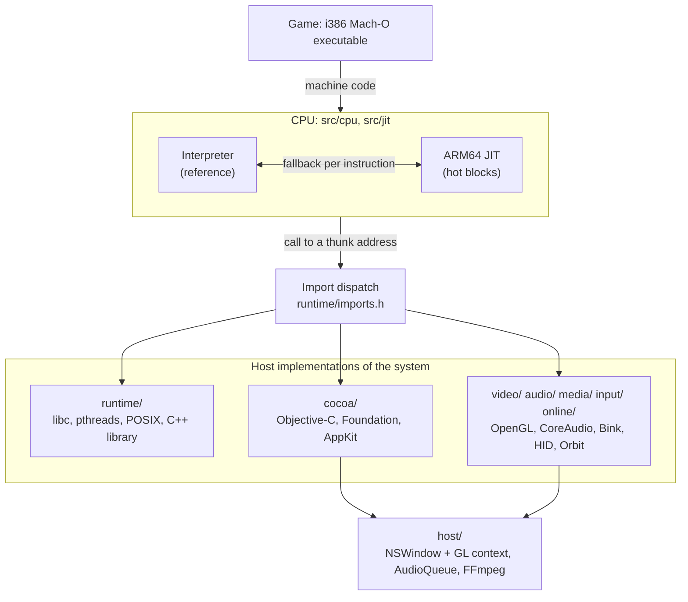
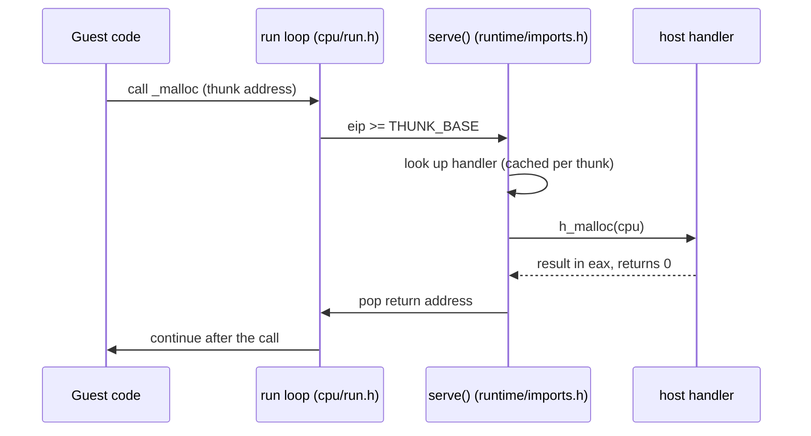
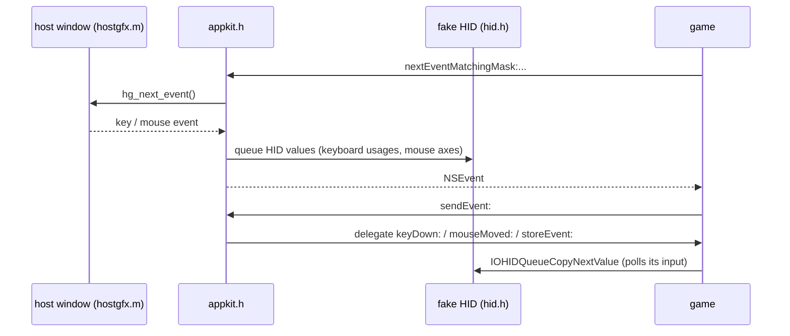

# Architecture

dcompile is a user-mode emulator for one process: the game. It does not emulate a machine. The CPU is emulated (x86-32 on
ARM64), the operating system is not: every call the game makes into the system is answered by host code, and the host's own
OpenGL, CoreAudio and AppKit do the real work. This approach is usually called high-level emulation.



## One translation unit

`src/main.c` includes `src/dcompile.h`, which includes every module header in dependency order, and the program is compiled
as a single translation unit (plus the two Objective-C files in `src/host`). That is deliberate: the interpreter, the JIT
helpers and the hundreds of import handlers all share the guest-memory accessors and the `CPU` struct, and their hot paths
rely on those being inlined. Module boundaries are enforced by layering instead of by linkage: a header may only use what is
included above it in `dcompile.h`. Each header starts with a comment saying what the module is and what it assumes.

## Guest address space

The guest is a 32-bit process in a flat 4 GiB host mapping: guest address `a` lives at `G + a`, so a guest pointer is a host
pointer plus a constant and import handlers read and write guest memory directly. The layout is documented in
`src/core/memory_map.h` (image, heap, thread stacks, extra images, host-managed data, magic return addresses, thunks).

## Calling the host: thunks and import handlers

When an image is loaded, each symbol it imports that no loaded image defines is assigned a *thunk address*
(`THUNK_BASE + index`, `core/thunk_table.h`). A guest `call` to such an address leaves the execution loop, and
`serve()` (`runtime/imports.h`) looks up the host handler for that symbol name and runs it.

A handler is written with the macros in `runtime/hle.h`:

```c
H(strlen) {                      // defines int h_strlen(CPU *c)
    RET(strlen(GS(A(0))));       // A(n): n-th cdecl argument; GS(): guest C string -> host pointer; RET: result in eax
    return 0;                    // 0: pop the return address; 1: handler set eip itself; BLOCKED: restart me later
}
```



Each module ends with a table of the imports it implements (`static const ImportEntry foo_imports[] = {IMPORT(strlen), ...}`)
and `imports.h` lists all tables. A symbol ending in `*` matches by prefix. `DC_MISSING=1` prints, at exit, the imports that
have no host implementation. Host code can call guest code with `call_guest()` (callbacks, Objective-C methods, initialisers).

## Execution engines

- **Interpreter** (`src/cpu`): `exec()` decodes and executes one instruction. Integer, x87 (host doubles with rounding and
  precision control) and SSE/SSE2/SSE3 are covered. It is the reference: simple and complete.
- **JIT** (`src/jit`): translates guest basic blocks to ARM64 on demand into a `MAP_JIT` cache, chains them, and keeps the
  eight guest registers in host registers. Anything it cannot translate natively calls `exec()` for that one instruction.
  Self-modifying code is handled by write-protecting translated pages. `jit/jit.h` documents the register mapping and the
  flag strategy.
- **Testing the JIT**: `make test` generates thousands of random instructions, runs each through both engines and compares
  registers, flags and every byte written. `DC_JITCHECK` does the same for every block of a real run.

## Threads

The game runs about twenty threads. Each has its own `CPU`; the host runs one at a time. The scheduler (`runtime/sched.h`)
switches only at the top level, when a thread blocks, exits, yields or uses up its slice of instructions, and never inside a
host-to-guest callback. A blocking import is *restarted*: the thread stays on the thunk and the handler re-evaluates its
condition when the thread is woken, so handlers need no saved state. Mutexes, condition variables, semaphores and read/write
locks (`runtime/threads.h`) are tables keyed by guest address. Two helper threads run asynchronous work on guest time: the
audio render pump and the file-I/O completion queue.

## Loading

`loader/` maps the Mach-O segments, applies the compressed rebase/bind opcode streams, records Objective-C sections and
symbols, and supports `dlopen`/`dlsym` for further images. Two game-specific concerns are isolated:

- `loader/protection.h` undoes the scrambling of the executable's code section. The key is recovered statistically from the
  section itself (x86 code is dominated by a few byte values; candidate keys are scored by how many function prologues they
  produce), not embedded.
- `loader/patches.h` applies a few binary patches, only to the exact executable they were written for (identified by SHA-256
  in `loader/build_id.h`). They keep the game from treating the missing online connection as fatal.

## Subsystems

| Directory | What it provides |
| --- | --- |
| `runtime/` | The heap, `libc` (string, wide, printf, stdio, math, atomics), POSIX, pthreads, a slice of libstdc++ 4.2 (COW `std::string`, red-black tree helpers), File Manager forks |
| `cocoa/` | An Objective-C runtime for the legacy i386 ABI, Foundation classes, CoreFoundation, and AppKit (application, window, OpenGL view/context, events, timers). The game's own class keeps its guest methods |
| `video/` | The game's 103 OpenGL entry points forwarded to the host's legacy GL 2.1 (Metal-backed, supports the ARB assembly programs the game uses), CoreGraphics display/CGL, frame capture |
| `audio/` | The AUGraph the game's mixer renders through; the render callback runs at real-time pace and its output goes to a host audio queue |
| `media/` | The Bink video API on top of FFmpeg: decode, colour-convert, upload as textures, play the audio track |
| `input/` | IOHID keyboard and mouse devices fed from host events; input injection for unattended runs |
| `online/` | A stand-in for Ubisoft's Orbit client library: always "connected", an offline account, savegames as files |
| `host/` | The only Objective-C: `NSWindow`/`NSOpenGLContext` creation, the event pump, cursor capture, and `AudioQueue` sinks. Everything else is plain C |

### Windowing and events

A guest `NSWindow`, `NSOpenGLView` or `NSOpenGLContext` is a small guest object holding an index into a host-object table
(`runtime/handles.h`); the real objects live in `host/hostgfx.m`. The shim advertises a virtual screen of at most 1280x800
and resizes the host window when the game asks for full screen. Events: the game's main loop calls
`nextEventMatchingMask:...`; the shim pulls a host event, mirrors it into the fake HID devices, returns a guest `NSEvent`, and
routes `sendEvent:` to the game's delegate. When the game hides the cursor the host cursor is frozen in place while mouse
deltas keep flowing, and released when the app loses focus.



### Savegames

The game stores saves through Orbit. The stand-in implements the list/read/write/remove calls on files named
`<product>_<id>.sav` (with a `.nam` file holding the name) under
`~/Library/Application Support/Ubisoft/Assassin's Creed 2/saves/`. The savegame id is derived from the name because the game
finds saves by name.

## Adding an import

1. Find the missing symbol: run with `DC_MISSING=1`, or note the `UNIMPLEMENTED IMPORT` line the run stops with.
2. Write `H(symbol) { ... }` in the module it belongs to (use `A(n)` for arguments; mind the i386 conventions: 64-bit values
   take two stack slots and are returned in edx:eax, floating point is returned in st(0) with `fpush()`).
3. Add `IMPORT(symbol)` to that module's table.

Guest structures have the i386 Darwin layout, not the host's: use explicit offsets (`rd(p + 4, 4)`) rather than host structs.

## Porting to another title

The CPU, loader, runtime and most of the system layer are generic. What is game-specific: `loader/build_id.h` and
`loader/patches.h` (the supported build and its patches), the Objective-C classes the game's own code defines, the Orbit
stand-in, and whichever Cocoa/Foundation classes and imports that title additionally uses. Start by running the game's
executable and implementing imports as the run reports them.
